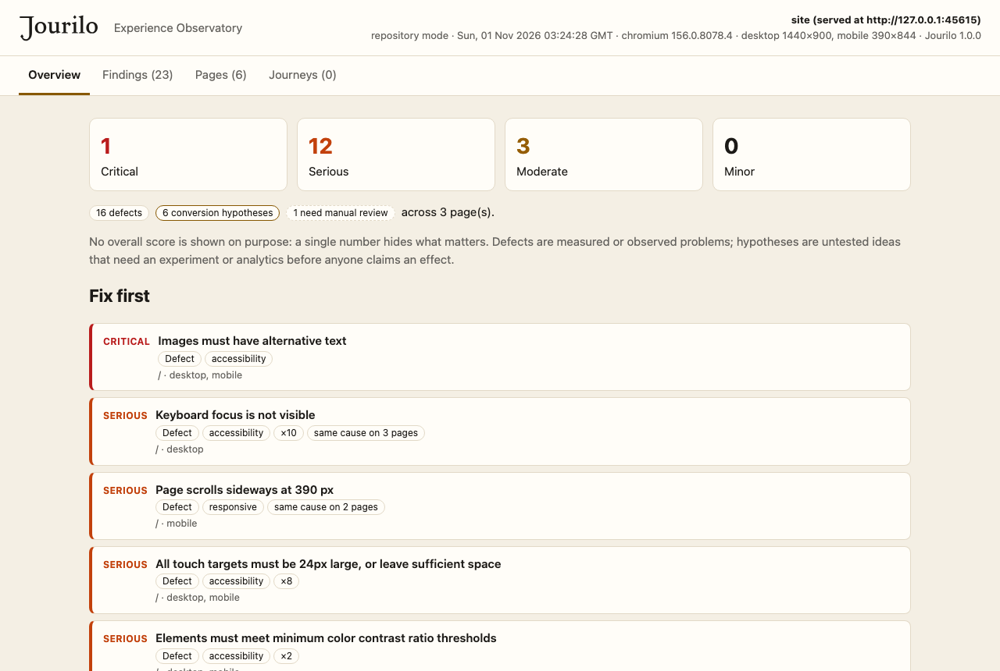
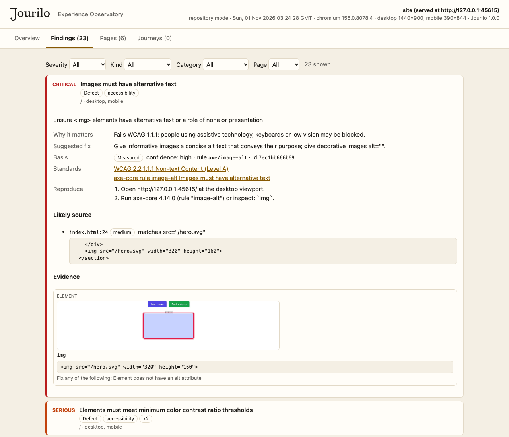
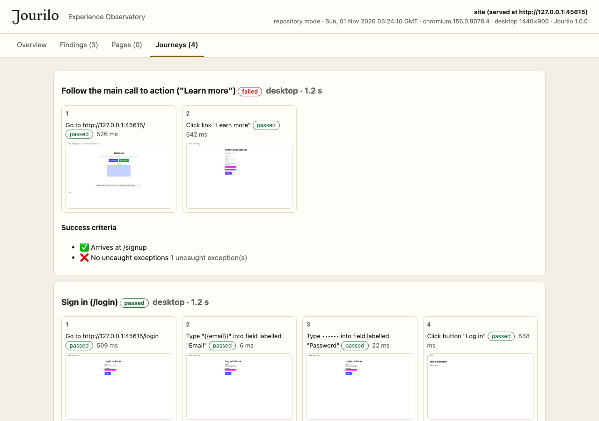

<h1>
  <picture>
    <source media="(prefers-color-scheme: dark)" srcset="docs/assets/brand/jourilo-wordmark-reversed.svg">
    
  </picture>
</h1>

**AI-powered product experience & conversion engineering studio.** Jourilo drives a real browser through your
product, finds UX, accessibility, performance and conversion problems with evidence, traces them to the code that
causes them, applies safe fixes and proves the result with a before/after run.

Local-first · evidence-driven · no paid services required · works as a CLI and as a Claude Code plugin · Apache-2.0



> Status: **1.0.0.** Tested in CI on Linux, macOS and Windows (Node 20 and 22) with Chromium, Firefox and WebKit. An
> automated run never proves WCAG conformance: see [Limitations](docs/LIMITATIONS.md) for what is not covered.

## What it does

|                             |                                                                                                                                                                                                                                                                                                                                                     |
| --------------------------- | --------------------------------------------------------------------------------------------------------------------------------------------------------------------------------------------------------------------------------------------------------------------------------------------------------------------------------------------------- |
| **Understand**              | `discover` maps a repository (Next.js, Nuxt, SvelteKit, Astro, Remix, React/Vue Router, Laravel, Flutter web, static sites, monorepos) or a live site: routes, dev command, design system, i18n, auth, payments, analytics, roles and candidate journeys. Every fact names the file or page it came from.                                           |
| **Audit in a real browser** | Playwright + axe-core 4.14 (WCAG 2.0–2.2 A/AA), a keyboard-only walk (focus visible, focus obscured, traps), target size, reflow at 320 px, horizontal overflow, input purpose, paste blocking, form error feedback, lab Web Vitals (LCP, CLS, FCP, TTFB, TBT; INP during journeys), JavaScript errors and failed requests — on desktop and mobile. |
| **Journeys**                | Reusable JSON scenarios with explicit success criteria, suggested from what the site actually contains, run with a screenshot per step. A safety policy never pays, deletes or cancels on non-local hosts.                                                                                                                                          |
| **Conversion**              | CTA prominence and clarity, value proposition, trust signals, signup/checkout friction, pricing clarity — always reported as **hypotheses**, never as predicted lifts, with experiment plans and the statistics to read real results.                                                                                                               |
| **Fix and verify**          | Findings point to likely source lines. `optimize` previews minimal fixes as diffs and applies them only with `--apply`, as one reversible change (atomic writes; rollback never overwrites later edits). `verify` repeats the exact scope and reports fixed, new and persisting problems.                                                           |
| **Report**                  | A self-contained HTML _Experience Observatory_ (screenshots with highlighted elements, reproduction steps, standards, sources, journeys, before/after), plus Markdown for PRs and SARIF for code scanning.                                                                                                                                          |

What Jourilo does **not** do: invent observations, give a single "UX score", claim WCAG compliance from an automated
run, or predict conversion gains. Each finding is labelled _measured_, _observed_, _heuristic_, _AI inference_ or
_user input_.

## Quick start

Requires Node.js ≥ 20.10.

```bash
npm install -g jourilo
```

```bash
jourilo setup
```

`setup` downloads Playwright's Chromium (one time, ~150 MB). Alternatively use an installed Chrome with
`--browser chrome`. To run without a global install, use `npx jourilo <command>`; from a clone of this repository,
`node plugin/dist/jourilo.mjs <command>`.

Audit a local static build (served on 127.0.0.1) and map findings to its source:

```bash
jourilo audit ./dist --repo .
```

Audit a running app or a website (read-only, respects robots.txt):

```bash
jourilo audit http://localhost:3000 --viewports desktop,mobile,reflow
```

The report is written to `.jourilo/runs/<run-id>/report.html` (git-ignored). Add `--json` to any command for
machine-readable output.

### Claude Code plugin

```text
/plugin marketplace add cihantopac/jourilo
/plugin install jourilo@jourilo
```

Then use `/jourilo:jourilo <url or path>` for the full workflow, or `/jourilo:discover`, `/jourilo:audit`,
`/jourilo:journeys`, `/jourilo:accessibility`, `/jourilo:conversion`, `/jourilo:optimize`, `/jourilo:compare`,
`/jourilo:report`, `/jourilo:experiment`. Plugin commands are namespaced; `/jourilo:jourilo` always works. Claude
Code may also accept a bare `/jourilo` when no other command uses that name; to make it permanent, install the
personal skill with `jourilo agent install claude-skill --write`. See [docs/PLUGIN.md](docs/PLUGIN.md).

Other agents: `jourilo agent install codex --write` (adds a section to `AGENTS.md`) or `cursor`
(`.cursor/rules/jourilo.mdc`).

## The improvement loop

```bash
jourilo audit http://localhost:3000 --repo .        # evidence + likely source lines
jourilo journeys suggest latest                     # edit .jourilo/journeys/*.json
jourilo journeys run --base http://localhost:3000   # step screenshots, success criteria
jourilo optimize latest --repo .                    # preview minimal diffs (dry run)
jourilo optimize latest --repo . --apply            # write as one reversible change
jourilo verify <baseline-run>                       # same scope again: fixed / new / persisting
jourilo rollback latest --yes                       # undo if needed
```

Measured on the seeded demo app (`fixtures/sites/acme-saas`): `verify` after `optimize --apply` reported 11 findings
fixed and 0 new; on a page with a late-loading image, adding the measured image size took mobile CLS from 0.121 to 0.
Fixes are idempotent and fully reversible (see [docs/EVALUATION.md](docs/EVALUATION.md)).

| Finding with evidence and root cause                                                                                                             | Journey storyboard                                                                                                 |
| ------------------------------------------------------------------------------------------------------------------------------------------------ | ------------------------------------------------------------------------------------------------------------------ |
|  |  |

## Detection quality

**Fixture benchmark** (`jourilo bench`, a CI gate): sites with seeded problems and clean control pages; it fails on
any miss, false positive or wrong root-cause file. 1.0.0: **45 / 45** seeded problems found, **0** false positives,
root cause in the expected file 9 / 9 (Chromium; the `acme-saas` set also in Firefox and WebKit). These fixtures were written alongside the
rules, so they show the rules work as designed.

**Independent benchmark** on the 955 [W3C ACT Rules](https://www.w3.org/WAI/standards-guidelines/act/rules/) test
cases that map to WCAG criteria, written by the ACT Rules Community Group, not for Jourilo:

| 2026-11-01            | Precision | Recall | False positives |
| --------------------- | --------- | ------ | --------------- |
| Jourilo 1.0.0         | 93.9 %    | 55.4 % | 11              |
| axe-core 4.14.0 alone | 93.6 %    | 53.5 % | 11              |

Jourilo runs axe-core internally; its own checks add keyboard-trap and focus-indicator detections without adding
false positives. Many misses are criteria that need a person (media alternatives, meaning, descriptive headings), which
every report lists under "Still needs a person". A separate comparison with Pa11y and Lighthouse on the 142 cases of the
[GOV.UK accessibility tool audit](https://alphagov.github.io/accessibility-tool-audit/) is in
[docs/EVALUATION.md](docs/EVALUATION.md#comparison), with its method and caveats.

## Safety and privacy

Audits are read-only, on every host: form validation is probed by simulating the submission, and nothing that would
change data leaves the browser unless you pass `--allow-submit`. Crawling stays on the target origin and respects
robots.txt. Every browser request goes through a local network guard, so an audited page cannot reach this machine,
the local network or cloud-metadata services (private targets need `--allow-private`). Journeys block payments,
purchases, deletions and cancellations however they are triggered (click, key, script, link) on any non-local host,
and on local hosts unless you pass `--allow-destructive`. Fixes are written as one reversible change, and rollback
never overwrites edits made afterwards. Password, card and marked fields are masked
in screenshots; tokens, keys, e-mail addresses and card numbers are redacted from logs and reports. Page content is
treated as untrusted data and is always HTML-escaped in reports. Details: [docs/PRIVACY.md](docs/PRIVACY.md),
[docs/SECURITY-REVIEW.md](docs/SECURITY-REVIEW.md) (including residual risks), [SECURITY.md](SECURITY.md).

## Works with Markilo and Searvex (optional)

If a project contains [Markilo](https://github.com/cihantopac/markilo) brand tokens, Jourilo checks buttons and fonts
against the brand and never recommends changing a locked brand color. If it contains
[Searvex](https://github.com/cihantopac/searvex) results, search findings for the same pages appear in the report.
Both are read through a small, versioned, tool-neutral contract, `jourilo.context/v1`
([docs/INTEGRATIONS.md](docs/INTEGRATIONS.md)). Neither is required.

## Documentation

- [CLI reference](docs/CLI.md) (generated from the code)
- [Architecture](docs/ARCHITECTURE.md) · [Decisions](docs/DECISIONS.md) · [Requirements and quality targets](docs/REQUIREMENTS.md)
- [Journeys format](docs/JOURNEYS.md) · [Claude Code plugin and agents](docs/PLUGIN.md) · [Integrations](docs/INTEGRATIONS.md)
- [Evaluation](docs/EVALUATION.md) · [Limitations](docs/LIMITATIONS.md) · [Roadmap](docs/ROADMAP.md) · [Progress log](docs/PROGRESS.md)
- Research: [tool landscape](docs/research/landscape.md) · [standards reference](docs/research/standards.md)

## Contributing

Bug reports, fixture sites with real-world UX problems and new rules are welcome. Start with
[CONTRIBUTING.md](CONTRIBUTING.md). Every rule needs a fixture that proves it fires and a control that proves it does
not.

## License

[Apache-2.0](LICENSE). Bundled third-party code: see [THIRD_PARTY_NOTICES.md](THIRD_PARTY_NOTICES.md).
