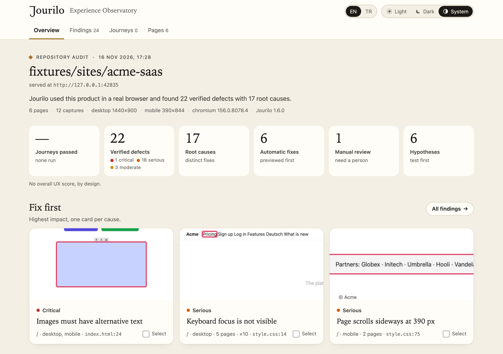
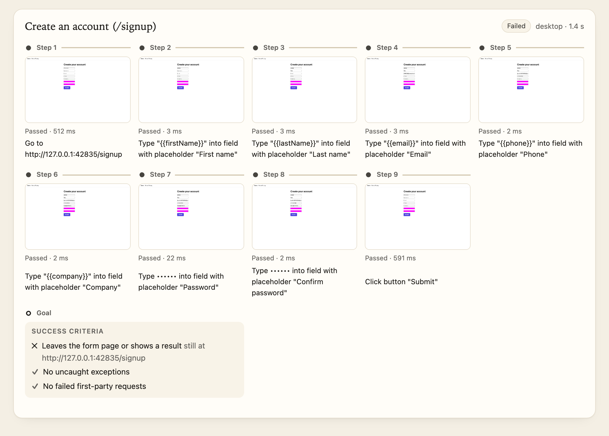
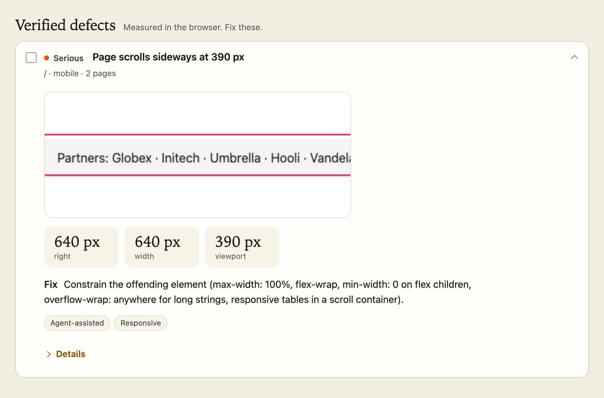
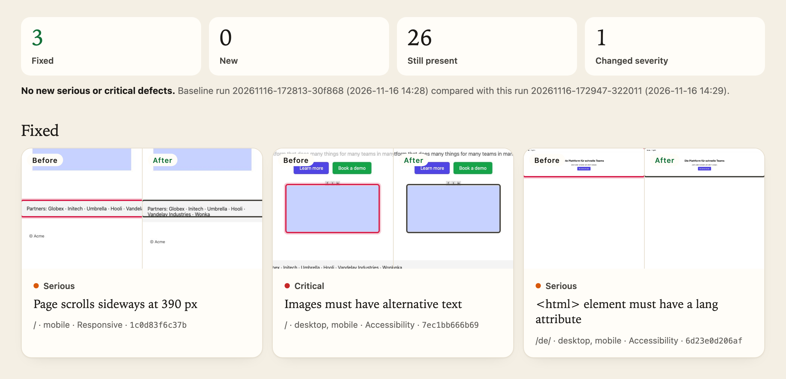
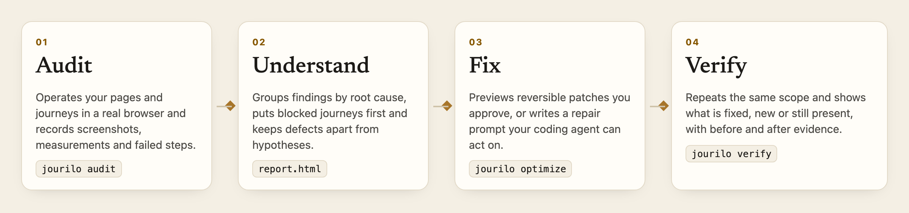

<p align="center">
  <picture>
    <source media="(prefers-color-scheme: dark)" srcset="https://raw.githubusercontent.com/cihantopac/jourilo/v1.6.0/docs/assets/brand/jourilo-wordmark-reversed.svg">
    
  </picture>
</p>

<h3 align="center">Walk every journey. Find the friction. Prove the fix.</h3>

<p align="center">
  Jourilo uses your product in a real browser, shows where people get stuck and proves every fix.
</p>

<p align="center">
  <a href="https://www.npmjs.com/package/jourilo"></a>
  <a href="https://github.com/cihantopac/jourilo/actions/workflows/ci.yml"></a>
  <a href="LICENSE"></a>
  
</p>

<p align="center">
  <a href="#install">Install</a> ·
  <a href="#claude-code">Claude Code</a> ·
  <a href="#benchmarks">Benchmarks</a> ·
  <a href="docs/WORKFLOW.md">Guide</a> ·
  <a href="#docs">Docs</a>
</p>

<picture>
  <source media="(prefers-color-scheme: dark)" srcset="https://raw.githubusercontent.com/cihantopac/jourilo/v1.6.0/docs/assets/report-overview-dark.png">
  
</picture>

## Journeys

Jourilo signs up, checks out and follows calls to action like a person would, with a screenshot of every step. When a
journey breaks, you see exactly where.



## Evidence

Each finding shows the element on its screenshot, the measured values and one fix; standards, reproduction steps and
source lines are one click away. The report is a single offline file, in English or Turkish, light or dark
([on a phone](https://raw.githubusercontent.com/cihantopac/jourilo/v1.6.0/docs/assets/report-mobile.png)).



## Fix & prove

Apply reviewed automatic fixes with `jourilo optimize`, or hand a
[repair prompt](https://raw.githubusercontent.com/cihantopac/jourilo/v1.6.0/docs/assets/report-prompt.png) to your coding
agent. `jourilo verify` repeats the same scope and shows what is fixed, new or still present.



## Install

```bash
npm install -g jourilo
jourilo setup
jourilo audit http://localhost:3000 --repo .
```

`setup` downloads Chromium once; the report lands in `.jourilo/runs/<run-id>/report.html`. The full loop:
[docs/WORKFLOW.md](docs/WORKFLOW.md).



## Claude Code

```text
/plugin marketplace add cihantopac/jourilo
/plugin install jourilo@jourilo
```

Then `/jourilo:jourilo https://your-site.dev` or `/jourilo:jourilo .`; all commands are in [docs/PLUGIN.md](docs/PLUGIN.md).

## Benchmarks

On the 955 [W3C ACT Rules](https://www.w3.org/WAI/standards-guidelines/act/rules/) test cases that map to WCAG criteria
(measured on 2026-11-13 for 1.3.0; method and more comparisons in [docs/EVALUATION.md](docs/EVALUATION.md)):

|                       | Precision | Recall | False positives |
| --------------------- | --------- | ------ | --------------- |
| Jourilo 1.3.0         | 93.4 %    | 56.1 % | 12              |
| axe-core 4.14.0 alone | 93.6 %    | 53.5 % | 11              |

## Safe by default

Read-only audits behind a network guard that respect robots.txt, journeys that never pay, delete or cancel on non-local
hosts, and secrets masked in screenshots ([privacy](docs/PRIVACY.md) · [security](SECURITY.md)).

## The family

- [**Relivaro**](https://github.com/cihantopac/relivaro): code quality, security and release readiness.
- [**Searvex**](https://github.com/cihantopac/searvex): SEO and AI-search findings for the same pages.
- [**Markilo**](https://github.com/cihantopac/markilo): brand identity; Jourilo checks its tokens and never changes a locked brand.

## Docs

[Guide](docs/WORKFLOW.md) · [CLI](docs/CLI.md) · [Plugin](docs/PLUGIN.md) · [Journeys](docs/JOURNEYS.md) ·
[Evaluation](docs/EVALUATION.md) · [Limitations](docs/LIMITATIONS.md) · [Integrations](docs/INTEGRATIONS.md) ·
[Architecture](docs/ARCHITECTURE.md) · [Changelog](CHANGELOG.md) · [1.6 release notes](docs/RELEASE-1.6.md) ·
[Contributing](CONTRIBUTING.md)

## License

[Apache-2.0](LICENSE). Bundled third-party code: [THIRD_PARTY_NOTICES.md](THIRD_PARTY_NOTICES.md).
